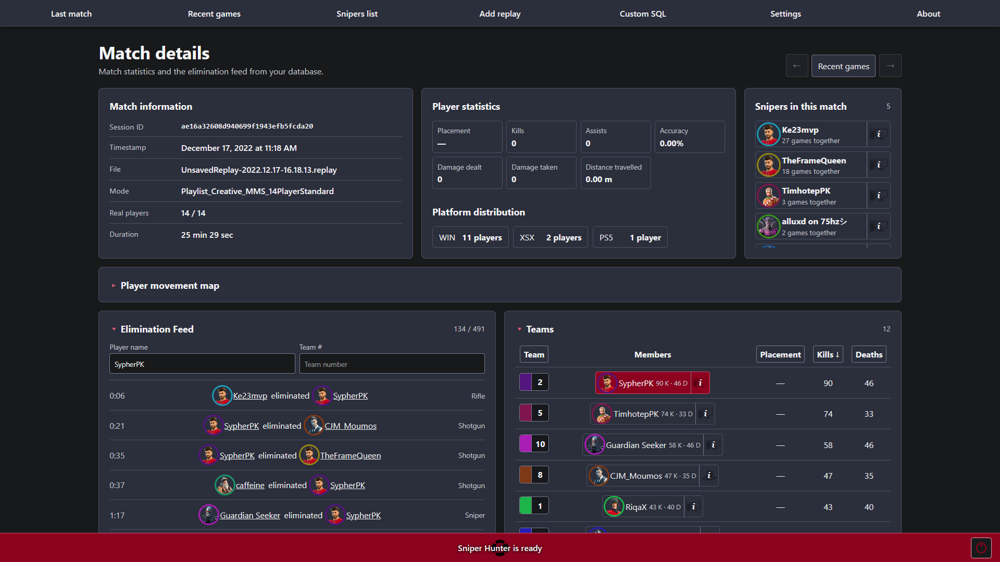
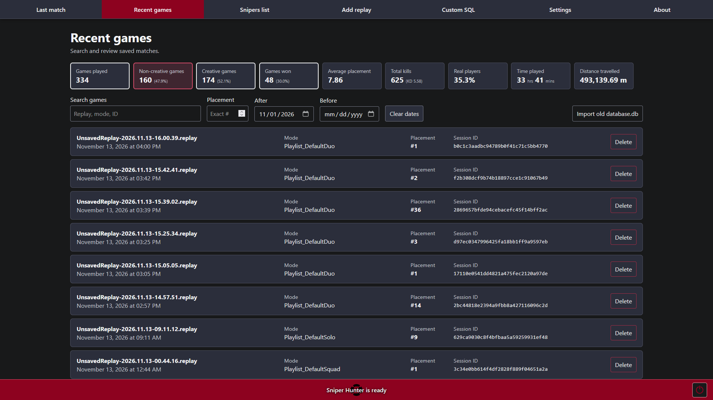
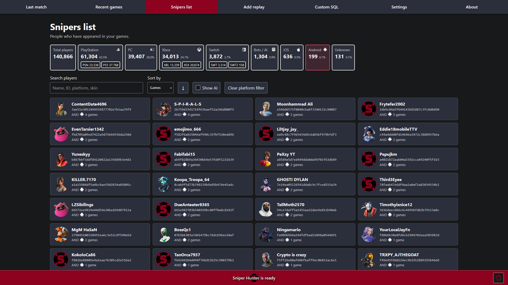
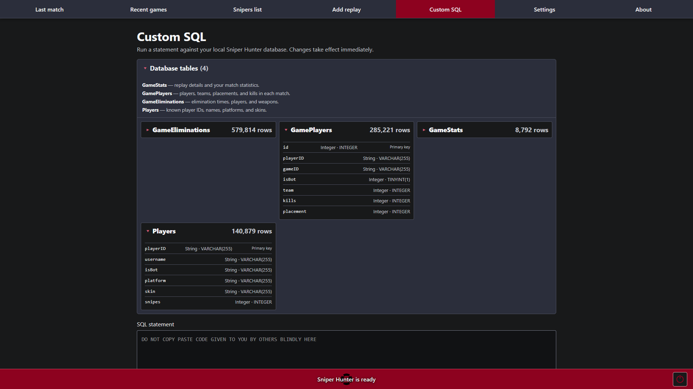
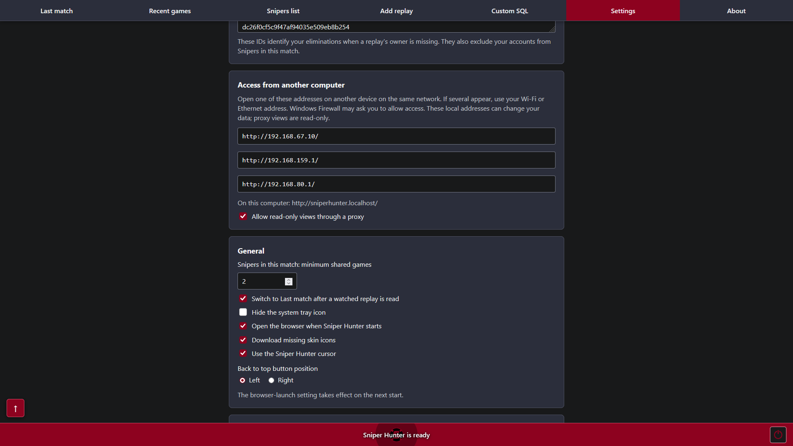

# Sniper Hunter

Sniper Hunter helps streamers spot repeat opponents and possible stream snipers, and gives casual players a straightforward way to track their Fortnite games. Created and maintained by **Guardian Seeker ([@gun.grave](https://discord.com/users/206530837213216769))**, this program reads completed replays and organizes match and player history on your computer. The first version helped SypherPK investigate stream snipers. Your database, settings, maps, and skin images stay in the program folder, there is a zero-data-collection policy.

> **PC only:** Sniper Hunter reads replay files saved on a Windows PC. It cannot retrieve replays from a console.

<table>
  <tr>
    <td align="center"> Replay</td>
    <td align="center"> Recent games</td>
    <td align="center"> Snipers list</td>
  </tr>
  <tr>
    <td align="center"> Custom SQL</td>
    <td align="center"> Settings</td>
    <td></td>
  </tr>
</table>

## Features

- **Last match and replays:** Review placement, eliminations, accuracy, damage, distance, platforms, repeat opponents, a searchable elimination feed, and sortable teams. Follow players on an interactive movement map with replay-time playback, storm and visibility shading, trails, zoom, and saved map alignment. Movement loads from the `.replay` file and is not stored in the database. Fortnite normally keeps only its latest 100 replay files; older movement is available only if you keep a copy of the matching replay in Fortnite's Demos folder.
- **Recent games:** Search and filter match history by date, placement, and game type. Review totals, wins, kills, KD, and time played; import an older database or delete games.
- **Snipers list and profiles:** Find players across a large history, filter by platform or AI, and review shared games, encounters, and teammate incidents.
- **Add replay:** Drop replay files or select them from Fortnite Demos. Automatic detection waits for completed replays; batch import shows progress and errors and skips games already added.
- **Custom SQL:** Browse the database schema, save queries, and export results as CSV.
- **Settings and access:** Manage owner accounts, network viewing, automatic navigation, the optional custom cursor, and a local Console. A single `config.json` holds settings and saved queries. Optional one-click GitHub release updates and missing-skin downloads are available.

## Download and setup

1. Download `SniperHunter.zip` from the current repository's Releases page and extract it to a folder location of your choice.
2. Ensure your PC has the [.NET 10 Runtime for Windows x64](https://dotnet.microsoft.com/en-us/download/dotnet/10.0), replays cannot be analyzed without this installed.
3. Run `SniperHunter.exe`. Keep the supplied `SniperHunterParser.exe` and `skins/` folder beside it. The database and settings are created there automatically; for old users of version 3.0+, you can place an existing `database.db` there before launch to automatically import your data.

**Optional:** Run Sniper Hunter as administrator once to let it set up `sniperhunter.localhost` if Windows does not already resolve it. Later launches can run normally. If Windows cannot resolve the name and you skip this step, Sniper Hunter uses `localhost`.

Sniper Hunter first tries `http://sniperhunter.localhost/` on port 80. If that port is unavailable, it automatically uses port 8008. If `sniperhunter.localhost` cannot resolve on your computer, it uses `localhost` instead. Administrator privileges are not required for startup. To choose a specific port, launch `SniperHunter.exe -port 8080`; that choice will not fall back to another port. Opening the EXE again takes you to the running instance.

## Donation

The program is free. If it helps you, you can leave an optional [Streamlabs tip](https://streamlabs.com/guardianseeker/tip) or [PayPal donation](https://www.paypal.com/paypalme/guardianseekers). The license permits free use and modification but restricts selling Sniper Hunter itself or a lightly repackaged copy; see [LICENSE](LICENSE).

## Build locally

Install Node.js and the .NET 10 runtime, then run `npm ci` and `npm ci --prefix web` in the project folder. Use `npm run dev` for a local development server, or `npm run build` on Windows to create `release/SniperHunter.exe`. Place your separately compiled `SniperHunterParser.exe` and the `skins/` folder beside the release executable, these can be retrieved from the latest release.

## Credits

- [Shiqan's FortniteReplayDecompressor](https://github.com/Shiqan/FortniteReplayDecompressor) for replay decoding.
- [Fortnite-API](https://fortnite-api.com/) for missing cosmetic images.
- ChatGPT Codex for development assistance.

## Support

For help, bugs, and suggestions, join the [Discord community](https://discord.gg/vw6Rh6J) or create a GitHub issue.

## Disclaimer and privacy

Sniper Hunter reads replay files after matches finish. It does not modify Fortnite or collect telemetry. Match history, settings, and console messages remain on your computer; no usage logs are sent to Sniper Hunter's creator. Optional update checks contact GitHub and missing cosmetic downloads contact Fortnite-API. If you enable network or proxy access, people you allow to connect can view the data exposed by that interface.

Sniper Hunter is not affiliated with or endorsed by Epic Games.
